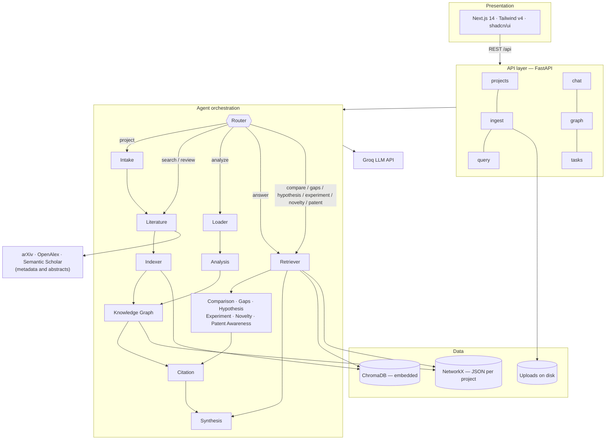

# Architecture

Written for the mid-review build; the overview, presentation, API, retrieval,
literature-search and data-flow sections were brought up to date in October
2026 (multi-source literature search, the `project` flow, graph-boosted
retrieval of fetched abstracts). The README is the full current description.
Where an earlier design document named Neo4j or Qdrant, this document is
authoritative: the implementation uses NetworkX and ChromaDB.

## System overview



## Layers

### 1. Presentation — `apps/web`

Next.js 14 App Router, React 18, Tailwind CSS **v4** (CSS-first config in
`globals.css`; there is deliberately no `tailwind.config.ts`), shadcn/ui
components over Radix primitives.

A project workspace has five tabs — Search & Upload, Chat & Q&A, Workflows,
Agent Activity, Knowledge Graph — and Projects, Tasks, Evaluation and Patents
are pages of their own. `next.config.js` rewrites `/api/*` to the backend so
the browser makes same-origin requests.

### 2. API — `apps/api`

FastAPI with Pydantic v2. Routers are thin: they validate, call a service, and
shape the response. Long-running agent work is started by `dispatch_pipeline`
(`app/routers/tasks.py`) on a thread of its own, so the server keeps answering
while it runs, and is observed by polling `/api/tasks/{id}`. With
`RUN_TASKS_INLINE` set (the test suite does) it runs as a FastAPI background
task instead, which the test client completes before returning.

`app/bootstrap.py` centralises the monorepo `sys.path` setup — this is
imported first by `main.py` and `tests/conftest.py`, and nothing else does path
manipulation.

### 3. Agents — `services/agents`

See the [README](../README.md#the-agents) for the full table. Two structural
decisions:

**Registry over graph.** `AgentOrchestrator.agents` is a `dict[str, BaseAgent]`
and `router.FLOWS` maps a flow name to an ordered list of agent names. Adding a
capability is: write the class, register it, name it in a flow.

**Contained failure.** `BaseAgent.safe_run` catches everything, logs a `failed`
event, appends to `intermediate_results["errors"]`, and returns the context.
The pipeline always reaches the end and always produces an answer field.

### 4. Ingestion — `services/ingestion`

```
PDF ─► PyMuPDF extract (per page) ─► RecursiveChunker ─► ChromaDB (embeds)
                                                    └──► KG agent (entities)
```

The chunker tries separators in order — `\n\n`, `\n`, `. `, ` ` — so a
boundary lands at the most semantically natural place available at the target
size. Overlap is clamped to half the chunk size (an overlap ≥ chunk size would
loop forever).

### 5. Retrieval — `services/retrieval`

1. Dense search in ChromaDB, filtered by `project_id`.
2. Graph traversal from entities linked to the query.
3. Reciprocal Rank Fusion, with a 1.5× boost for chunks reachable in the graph.
   The graph cites an uploaded passage by its chunk id, and a fetched abstract
   by its document id (the abstract is indexed split into several chunks), so
   either match counts.
4. Optional cross-encoder re-ranking (implemented, off by default — it adds a
   second model download and ~200 ms per query).

### 6. Knowledge graph — `services/knowledge_graph`

One `networkx.DiGraph` per project, saved atomically as JSON.

Node attributes: `type`, `description`, `mentions`, `source_chunk_ids`.
Edge attributes: `relation`, `confidence`.

Entity types: `Concept`, `Method`, `Person`, `Dataset`, `Metric`, `Paper`,
`Task`. Relation types: `USES`, `EXTENDS`, `COMPARES_TO`, `PART_OF`,
`AUTHORED_BY`, `EVALUATED_ON`, `IMPROVES`, `RELATED_TO`. Both are validated on
write — anything else collapses to `Concept` / `RELATED_TO`.

Serialisation passes `edges="links"` explicitly to `node_link_data`, which
NetworkX ≥ 3.4 requires to avoid a `FutureWarning` and a key rename.

### 7. Generation — `services/generation`

`provider.py` is the single place that decides which chat model the system
uses. Groq when `GROQ_API_KEY` is set; otherwise `OfflineChatModel`, a real
LangChain `BaseChatModel` that returns schema-correct output derived from the
prompt. Each agent prompt starts with a `[MAIROS-TASK: ...]` marker so the
offline model knows which shape to produce; hosted models ignore it.

`llm.py` owns the grounded-answer prompt and the numbered source-block format.

### 8. Evaluation — `services/evaluation`

`metrics.py` holds dependency-free implementations of Recall@k, Precision@k,
reciprocal rank and nDCG@k, so each can be checked against a hand-worked
example in a unit test. `golden_set.py` loads the curated cases *and* owns the
relevance rule they use — a documented keyword proxy, or explicit document
labels when a case supplies them. `runner.py` scores a real retriever: it scans
the project's corpus to get a true Recall denominator, excludes cases whose
evidence is absent from that corpus, and reports whether the optional RAGAS
dependency is present rather than substituting a placeholder score.

### 9. Research workflows — `services/agents`

Five agents share one contract: state only what a retrieved passage supports.
`evidence.py` implements that contract once — it groups chunks into labelled
sources for prompting and attaches the passage that best supports a returned
claim by content-word overlap. Comparison, gaps, hypothesis, experiment and
patent awareness all drop output they cannot link back, and count what they
dropped.

The dependency between them lives in `router.FLOWS`, not inside the agents:
`hypothesis` runs gap detection ahead of itself, `experiment` runs the whole
chain. Each agent still reads its input from `intermediate_results` and can be
tested alone.

### 10. Patent awareness — `services/patents`

The safety boundary of the patent prototype: an allowlist of free public
registries, a validator that rejects anything else, and the standing
disclaimer. There is deliberately no fetch path — patent text is user-supplied,
which removes the request-forgery surface and keeps MAIROS clear of commercial
database terms. Overlap findings are computed in Python; the LLM only phrases a
summary of findings that already exist.

### 11. Literature search — `services/literature`

One search runs several queries against arXiv, OpenAlex and Semantic Scholar at
once. The live model writes the queries, with rules over the text as the
fallback (`queries.py`); every source is a small client that reports a failure
or a rate limit instead of raising one (`sources.py`). Results are merged when
they share a DOI, an arXiv id or a title, ranked by reciprocal-rank fusion
blended with their wording overlap with the topic (`merge.py`), and the search
is summarised in a coverage report — sources and their status, queries, counts,
years, warnings — computed rather than written by a model (`coverage.py`). Only
titles, abstracts and metadata are fetched, and a paper link is kept only when
it points at `arxiv.org`, `doi.org`, `openalex.org` or `semanticscholar.org`
(`papers.py`).

## Data flow

**Ingest.** Upload → save to disk → extract → chunk → embed into ChromaDB →
register in the metadata store → start an `analyze` task in the background.

**Search.** Question → Router picks `search` → Literature searches arXiv,
OpenAlex and Semantic Scholar and records a coverage report → Indexer embeds
the abstracts → KG agent adds papers, authors, concepts → Citation formats APA
→ Synthesis writes an overview citing each paper.

**Project review.** A pasted project description → Router picks `project` by
rule (a long description, or one that describes the user's own work) → Intake
reads it into a brief whose items must be supported by the description's own
words → Literature searches for the brief → Indexer → KG agent builds the
graph before anything reads it → Retriever → Comparison → Gaps → Novelty checks
each stated contribution for coverage → Citation → Synthesis heads the answer
with the brief and what was searched.

**Answer.** Question → Router picks `answer` → Retriever runs hybrid retrieval
→ Synthesis generates strictly from those passages → Citation lists sources.

**Research workflows.** Request → Router picks `compare` / `gaps` /
`hypothesis` / `experiment` / `novelty` / `patent` → Retriever supplies passages → the
workflow agent produces structured output, dropping anything it cannot cite →
Citation and Synthesis close the run as usual. The chained flows
(`hypothesis`, `experiment`) run their prerequisites first, so a hypothesis
always has a gap behind it and a design always has a hypothesis.

**Evaluation.** Not an agent flow: `POST /projects/{id}/evaluation/run` calls
the retriever directly for each golden-set question, scores the ranking, and
returns the report. Keeping it out of the orchestrator means the metrics
measure retrieval itself rather than whatever an agent pipeline did around it.

## Technology choices

| Concern | Choice | Why |
|---|---|---|
| Frontend | Next.js 14, Tailwind v4, shadcn/ui | App Router; CSS-first theming; accessible Radix primitives |
| Backend | FastAPI, Pydantic v2 | Async, typed, free OpenAPI docs |
| Vector DB | ChromaDB (embedded) | No server, no Docker for a demo |
| Embeddings | `all-MiniLM-L6-v2` | 384-dim, fast on CPU, ~90 MB |
| Graph | NetworkX + JSON | Sufficient at this scale; no service to run |
| LLM | Groq (`llama-3.3-70b-versatile`) | Fast, free tier |
| Orchestration | Custom registry | Flows are linear; LangGraph adds indirection without removing logic |
| Evaluation | RAGAS (scaffolded) | Standard RAG metrics |
